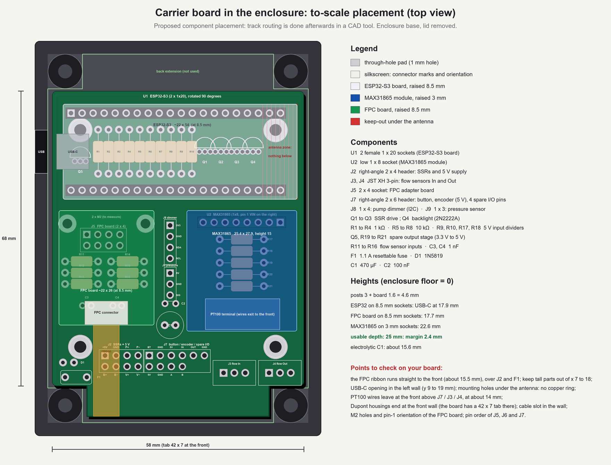
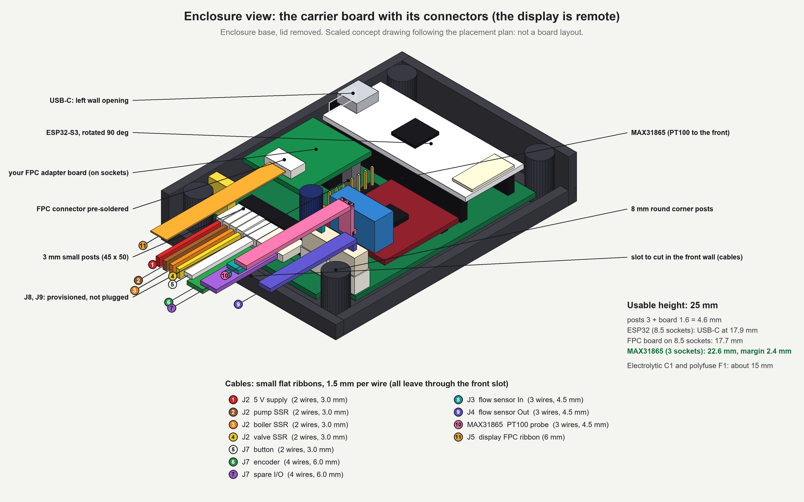
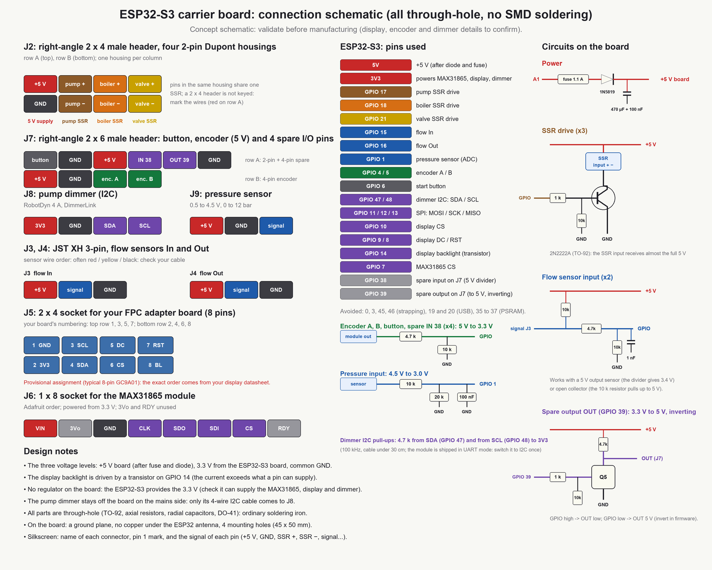

# esp32_coffee_screen: electronics design

Carrier board that moves the espresso machine (firmware: [coffee_screen](https://github.com/vivien22/coffee_screen)) from an Arduino Nano to an **ESP32-S3 Nano (N16R8)**, inside the existing plastic enclosure.

Status: **working design, nothing has been manufactured.** Placement is to scale, but track routing still has to be done in a CAD tool.

## Overview

### Placement inside the enclosure (to scale, top view)

### 3D view of the enclosure with the board and its cables

### Connection schematic

## Contents
- `docs/carrier_spec.md`: full specification (dimensions, connectors, pin assignment, circuits, bill of materials, open points).
- `images/`: the three pictures above, all generated from the scripts in `tools/` (Python + Pillow + numpy; measurements are at the top of each file): `placement_plan.py`, `enclosure_view.py`, `connection_schematic.py`.

## Principles
- 58 x 68 mm board with a 42 x 7 mm tab on the cable side, in the plus-shaped free area of the 60 x 85 mm enclosure (8 x 8 mm corner posts), on four 3 mm standoffs (45 x 50 mm spacing), 25 mm usable depth.
- Through-hole parts only (no SMD soldering).
- ESP32-S3 (rotated 90 degrees, USB-C to the left) and MAX31865 module on sockets; FPC adapter board (remote display) on a 2 x 4 socket, its ribbon going straight to the front.
- SSRs are kept, driven by 2N2222A transistors from the external 5 V supply.
- Connectors: J2 2 x 4 (5 V + 3 SSRs), J7 1 x 6 (button + encoder, 5 V), J8 1 x 4 (pump dimmer, I2C), J9 1 x 3 (pressure sensor), 2 x JST XH 3-pin (flow sensors).

## To confirm before manufacturing
See the end of `docs/carrier_spec.md`.
